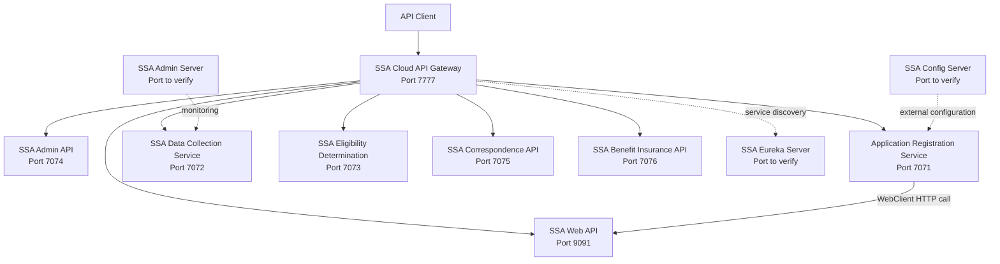
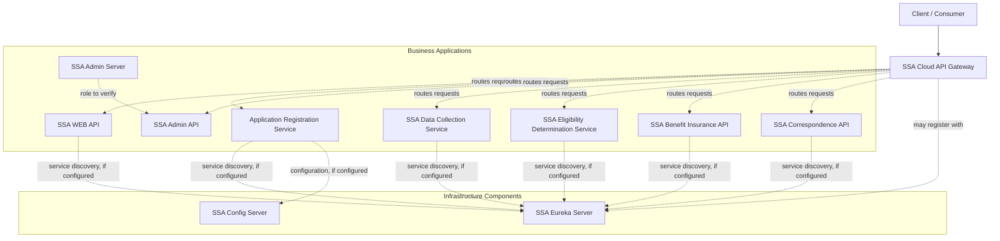
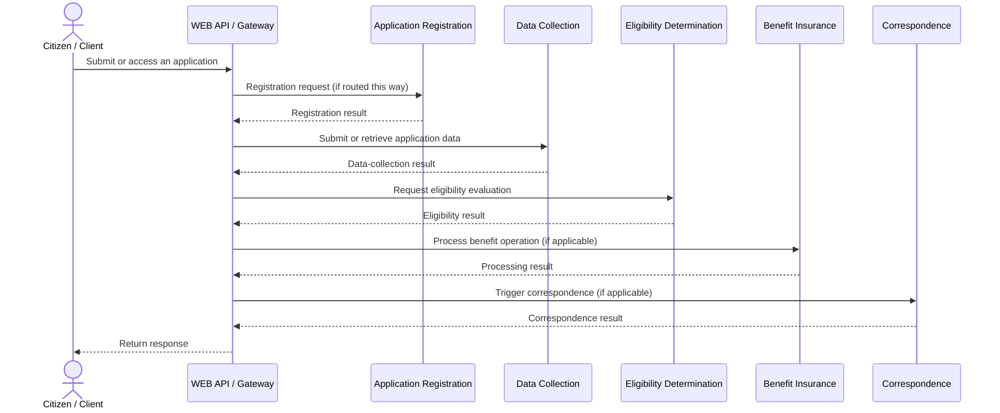

# Insurance System for Health

A Java and Spring Boot microservices-based application for a citizen health-insurance assistance workflow. The system separates application registration, plan administration, data collection, eligibility determination, correspondence generation, and benefit-report processing into independently configured services, supported by an API Gateway and service-discovery/configuration infrastructure.

This README consolidates the supplied service-level analyses and the architecture and sequence diagrams. Endpoint and behavior details are included where they were identified in those analyses. Some infrastructure modules and cross-service interactions still require verification against the complete source code.

## Contents

- [Project overview](#project-overview)
- [Architecture](#architecture)
- [Application sequence](#application-sequence)
- [Modules](#modules)
- [REST API reference](#rest-api-reference)
- [Business workflows](#business-workflows)
- [Technology stack](#technology-stack)
- [Running locally](#running-locally)
- [Known gaps and security notes](#known-gaps-and-security-notes)

## Project overview

The project models a health-insurance assistance process in which a citizen application can be registered, supporting information can be collected, eligibility can be evaluated, and a correspondence notice can be generated. A separate benefit-processing batch module exports beneficiary data to a CSV file. The API Gateway provides routed entry points to the service APIs, while Eureka and Config Server modules are intended to support service discovery and externalized configuration.

### Main capabilities

- Citizen application registration and state lookup.
- Health-plan administration, including create, list, update, status change, and delete operations.
- Collection of application case details such as selected plan, income, education, and child information.
- Eligibility evaluation and creation of a correspondence trigger.
- Generation and storage of PDF correspondence documents.
- Batch export of benefit-related records to CSV.
- Gateway routing and infrastructure modules for service discovery, configuration, and administration.

> **Implementation note:** These are capabilities indicated by the supplied code analyses, not a claim that every module currently builds or that the complete workflow is operational end to end. Known gaps are documented below.

## Architecture



The diagram reflects reported module names, gateway route targets, and configured local ports. It does not guarantee that all services currently build or run together. Some source reports identify missing Java files or external database configuration.

The high-level component view can also be represented with logical infrastructure and business groupings:



Dashed links above represent intended or potential relationships; verify each module's actual configuration before treating every link as active. In particular, the Admin Server relationship and whether each service uses Config Server must be confirmed from source configuration.

## Application sequence

The following sequence illustrates the intended high-level citizen application journey. It is a business-flow overview, not proof that every arrow is implemented as a synchronous runtime call. The supplied analysis confirms some individual service calls and workflows, while the complete end-to-end orchestration should be verified in the code.



In the analyzed implementation, eligibility determination creates a pending correspondence trigger, Correspondence API processes pending triggers to generate PDF notices, and the Benefit API launches a batch job that exports records to CSV. Do not interpret the diagram as proof that benefits are paid or email is delivered.

## Modules

| Module | Responsibility reported by the source analysis | Port | Notes |
|---|---|---:|---|
| `ApplicationRegistrationService` | Registers a citizen application after checking the submitted SSN through the SSA Web API. | 7071 | Database configuration is not present in checked-in config; context test reportedly fails without datasource settings. |
| `SSA-AdminAPI` | Plan registration, listing, lookup, update, status change, deletion, and plan-category listing. | 7074 | `IPlanRepository` source is missing, so the project does not compile as supplied. |
| `SSA-AdminServer` | Admin/monitoring server module, inferred from folder name. | Not verified | Detailed source analysis was not supplied. |
| `SSA-BenifitInsuranceAPI` | Starts a Spring Batch job that reads eligibility records and writes a beneficiary CSV. | 7076 | `ElgibilityDetailsEntity` and `IElgibilityDeterminationRepository` sources are missing; datasource/schema are not supplied. |
| `SSA-CloudAPIGateway` | Routes requests to Eureka-discovered service IDs. | 7777 | Route predicates are documented below. |
| `SSA-ConfigServerGit` | Config Server-related module, inferred from folder name. | Not verified | Detailed source analysis was not supplied. |
| `SSA-CorrespondenceAPI` | Processes pending triggers, generates PDF notices, stores PDF bytes, and marks triggers completed. | 7075 | Email sending is commented out; asynchronous summary counters are unreliable. |
| `SSA-DataCollectionService` | Creates cases, records plan selection, income, education, children, and intends to assemble a summary. | 7072 | `/dc-api/summary` has a path-variable mismatch; `/planNames` currently returns an empty list. |
| `SSA-ElgibilityDeterminationService` | Evaluates eligibility, saves a determination, and creates a pending correspondence trigger. | 7073 | Uses repository-based persistence; database configuration is incomplete. |
| `SSA-EurekaServer` | Service registry, inferred from folder name. | Client URL uses port 8761 | Detailed server-source analysis was not supplied; verify actual server configuration. |
| `SSA-WEB-API` | Maps the final two digits of a numeric SSN input to a hard-coded state string. | 9091 | This is a simple lookup, not comprehensive SSN validation. |

Folder names retain the spelling used in the repository, including `Benifit` and `Elgibility`.

## REST API reference

Direct URLs below use ports reported in the corresponding service configurations. Gateway path patterns are listed separately; a gateway predicate is not itself proof of the downstream service's complete API contract.

### Application Registration Service — `http://localhost:7071`

| Method | Endpoint | Input | Response / behavior |
|---|---|---|---|
| `POST` | `/CitizenAR-api/save` | JSON `CitizenAppRegistrationInputs`: `fullName`, `email`, `gender`, `phoneNo`, `ssn`, `stateName`, `dob` | `201 Created`, plain text containing the new application ID. Invalid state/SSN path can return `400` with `Invalid SSn`. |

The service calls `GET http://localhost:9091/ssa-web-api/find/{ssn}` using `WebClient`. It compares the returned state with the configured target state (`california` by default) and persists accepted applications. No request-field validation constraints were found in the inspected DTO.

### SSA Admin API — `http://localhost:7074`

| Method | Endpoint | Input | Response / behavior |
|---|---|---|---|
| `GET` | `/plan-api/categories` | None | `Map<Integer, String>` of category IDs to names |
| `POST` | `/plan-api/register` | `PlanData` JSON | `String` result |
| `GET` | `/plan-api/all` | None | `List<PlanData>` |
| `GET` | `/plan-api/find/{planId}` | `planId` path variable (`Integer`) | `PlanData`, or `null` when not found |
| `PUT` | `/plan-api/update` | `PlanData` JSON | `String` result |
| `DELETE` | `/plan-api/delete/{planId}` | `planId` path variable (`Integer`) | `String` result |
| `PUT` | `/plan-api/status-change/{planId}/{status}` | `planId` (`Integer`) and `status` (`String`) path variables | `String` result |

`PlanData` contains `planId`, `planName`, `startDate`, `endDate`, `description`, and `activeSw`. The source report identifies a missing `IPlanRepository` file, so the service cannot currently compile as supplied.

### SSA Web API — `http://localhost:9091`

| Method | Endpoint | Input | Response / behavior |
|---|---|---|---|
| `GET` | `/ssa-web-api/find/{ssn}` | `ssn` path variable bound to `Integer` | Returns a hard-coded state string for supported remainders; returns `400` with `Invalid ssn` when the integer's string representation is not nine characters long. |

Current mapping from `ssn % 100`: `1` → `washington DC`, `2` → `ohio`, `3` → `teaxas`, `4` → `california`, `5` → `flodra`. Other remainders currently reach the success branch with a null body. These strings reflect the current implementation, not official SSN/state rules.

### Data Collection Service — `http://localhost:7072`

| Method | Endpoint | Input | Response / behavior |
|---|---|---|---|
| `GET` | `/dc-api/planNames` | None | `List<String>`; currently returns an empty list |
| `POST` | `/dc-api/generateCaseNo/{appId}` | `appId` path variable | `Integer`; creates a case only if a citizen-application row already exists in the local database |
| `PUT` | `/dc-api/updatePlanSelection` | `PlanSectionInputs` JSON | `Integer`; updates a case's plan; returns `0` if case is missing |
| `POST` | `/dc-api/saveIncome` | `IncomeInputs` JSON | `201 Created`; returns submitted case number |
| `POST` | `/dc-api/saveEducation` | `EducationInputs` JSON | `201 Created`; returns submitted case number |
| `POST` | `/dc-api/saveChildren` | JSON array / `List<ChildInputs>` | `201 Created`; persists children and returns the first item's case number |
| `GET` | `/dc-api/summary` | Handler declares `@PathVariable Integer CaseNo`, but the route has no matching template variable | Intended to return `DcSummaryReport`; mapping is currently incorrect |

DTOs reported include `PlanSectionInputs`, `IncomeInputs`, `EducationInputs`, `ChildInputs`, `CitizenAppRegistrationInputs`, and `DcSummaryReport`. Empty child lists are not handled by the current implementation.

### Eligibility Determination Service — `http://localhost:7073`

| Method | Endpoint | Input | Response / behavior |
|---|---|---|---|
| `GET` | `/ed-api/determine/{caseNo}` | `caseNo` path variable (`Integer`); no body/query parameters | `ElgibilityDetailsOutput`; controller reports `201 Created` on success |

The service loads case, plan, applicant and relevant income/child/education records; saves an eligibility determination; and creates a correspondence trigger with status `pending`.

Current rules reported in the implementation (not official policy):

| Plan | Decision condition | Benefit when approved |
|---|---|---:|
| `SNAP` | Employee income ≤ 300 | 200 |
| `CCAP` | Employee income ≤ 300 and at least one child under 16 | 300 |
| `MEDCARE` | Citizen age ≥ 60 | 200 |
| `MEDICAID` | Employee income ≤ 300 and property income is zero | 200 |
| `CAJW` | Employee income is zero and pass-out year is before the current year | 300 |
| `QHP` | Citizen age > 1 | Not set |

Approved plans receive a start date of the current date and an end date two years later. Some denial messages reportedly do not match the actual conditions.

### Correspondence API — `http://localhost:7075`

| Method | Endpoint | Input | Response / behavior |
|---|---|---|---|
| `GET` | `/co-triggers-api/process` | None | `ResponseEntity<CoSummary>` containing `totalTriggers`, `successTriggers`, and `pendingTriggers` |

The service reads pending triggers, loads eligibility/case/applicant records, generates a PDF, stores its bytes in the trigger record, and marks it completed. The email-sending call is commented out. Processing is submitted to a thread pool but the service does not wait for tasks before returning the summary, so the counts may be inaccurate.

### Benefit Insurance API — `http://localhost:7076`

| Method | Endpoint | Input | Response / behavior |
|---|---|---|---|
| `GET` | `/bi-api/send` | None | Text containing the Spring Batch job exit status; returns HTTP 200 on normal completion |

The batch job reads eligibility records sorted by `caseNo`, filters/transforms records, and writes `beneficiries_list.csv` in the process working directory. Configured fields include `caseNo`, `holderName`, `holderSSN`, `planName`, `planEndDate`, `benifitAmt`, `bankName`, and `accountNumber`. Accepted benefit amounts are calculated as the stored amount (or zero if absent) multiplied by `1.05` after filtering.

The source report says `ElgibilityDetailsEntity` and `IElgibilityDeterminationRepository` are referenced but absent from source, and database/schema settings are missing. The CSV includes SSN and bank-account fields; treat it as sensitive and never commit it.

### API Gateway routes — `http://localhost:7777`

| Gateway path predicate | Eureka service ID |
|---|---|
| `/plan-api/**` | `SSA-ADMINAPI` |
| `/CitizenAR-api/**` | `ApplicationRegistrationServices` |
| `/co-triggers-api/**` | `SSA-CorrespondenceAPI` |
| `/dc-api/**` | `SSA-DataCollectionService` |
| `/ed-api/**` | `SSA-ElgibilityDeterminationService` |
| `/ssa-web-api/**` | `SSA-WEB-API` |
| `/bi-api/**` | `SSA-BenifitInsuranceAPI` |

Routes use `lb://<service-id>` and the analyzed Gateway configuration did not include a rewrite/strip-prefix filter. Target services must register with matching IDs in Eureka. These are path predicates, not additional controller endpoints.

### Framework-provided endpoints

Some services include Actuator and/or Springdoc. Depending on each service's dependencies and configuration, framework routes may include `/actuator`, `/v3/api-docs`, and `/swagger-ui/index.html` or `/swagger-ui.html`. These are dependency-provided routes, not business controller mappings. Confirm exact availability at runtime.

## Business workflows

1. **Registration:** `POST /CitizenAR-api/save` calls the SSA Web API, checks the returned state against the configured state, then saves the application.
2. **Data collection:** A case is created for an existing application; plan selection, income, education, and child data are stored through the Data Collection API.
3. **Eligibility:** `GET /ed-api/determine/{caseNo}` evaluates plan rules, stores the decision, and creates a pending correspondence trigger.
4. **Correspondence:** `GET /co-triggers-api/process` processes pending triggers and generates/stores PDF notices. Email delivery is not active in the inspected source.
5. **Benefits batch:** `GET /bi-api/send` launches a Spring Batch job that writes beneficiary details to CSV. This does not implement a payment transfer in the reviewed code.

## Technology stack

The individual module reports confirm or declare Java 17, Spring Boot, Spring Web/MVC, Spring Data JPA, MySQL Connector/J in several POMs, Spring Cloud Netflix Eureka Client, Spring Cloud Config Client in selected services, Spring Cloud Gateway, Spring Batch in the Benefit API, Actuator, Spring Boot Admin Client, Springdoc OpenAPI in selected services, OpenPDF in Correspondence API, Lombok, Maven Wrapper, and Spring Boot Test.

Version differences were reported across modules: most business-service analyses list Spring Boot `3.5.8` and Spring Cloud BOM `2025.0.1`, while the Gateway analysis lists Spring Boot `3.5.16` and Spring Cloud BOM `2025.0.3`. Check each module's own `pom.xml` before treating these as a single project-wide version. Spring Security was not found in the analyzed business services.

## Running locally

### Prerequisites

- JDK 17.
- The Maven Wrapper in each service directory (`mvnw.cmd` on Windows, `./mvnw` on macOS/Linux).
- Valid database connection settings and schema for JPA services. Several analyses note that datasource URLs, credentials, or schema scripts are absent from checked-in configuration.
- Eureka Server for discovery and Gateway load balancing.
- Spring Boot Admin Server if monitoring registration is required.
- Config Server only where external configuration is intended; several services use an optional Config Server import.

### Build and run an individual service

Run from the relevant service folder.

Windows PowerShell:

```powershell
.\mvnw.cmd test
.\mvnw.cmd spring-boot:run
```

macOS/Linux:

```bash
./mvnw test
./mvnw spring-boot:run
```

The available reports identify these blockers or caveats:

- `SSA-AdminAPI`: missing `IPlanRepository` source.
- `SSA-BenifitInsuranceAPI`: missing `ElgibilityDetailsEntity` and `IElgibilityDeterminationRepository` sources, plus missing datasource/schema configuration.
- `ApplicationRegistrationService`: datasource configuration is missing; its context-load test reportedly fails while determining a suitable driver.
- `SSA-DataCollectionService`: datasource configuration is incomplete and `/dc-api/summary` has a path-variable mismatch.
- `SSA-AdminServer`, `SSA-ConfigServerGit`, and `SSA-EurekaServer`: module names were supplied, but their detailed source analyses were not; verify their actual ports, profiles, and startup requirements from their own source files.

## Known gaps and security notes

- Some services perform state-changing work through `GET` endpoints (`/ed-api/determine/{caseNo}`, `/co-triggers-api/process`, `/bi-api/send`). Consider `POST` for operations that mutate data or start jobs.
- The Data Collection `summary` mapping is inconsistent, and `planNames` currently returns an empty list.
- The SSA Web API uses a hard-coded remainder mapping rather than comprehensive SSN validation.
- Correspondence processing has asynchronous task/counter issues and does not actively send email.
- The Benefit API produces a CSV containing SSN and bank account data. Do not commit it or expose it publicly.
- Some service configurations expose all Actuator endpoints and environment values. Restrict management endpoints and protect sensitive configuration before deployment.
- The supplied analyses did not find Spring Security configuration in the documented business services. Do not assume authentication is enforced.
- Database settings and schema setup are incomplete in multiple modules.
- Detailed implementation for `SSA-AdminServer`, `SSA-ConfigServerGit`, and `SSA-EurekaServer` remains to be verified.

## Author

**Shivam Kumar Gupta**  
GitHub: [shivam-kg-se](https://github.com/shivam-kg-se)
