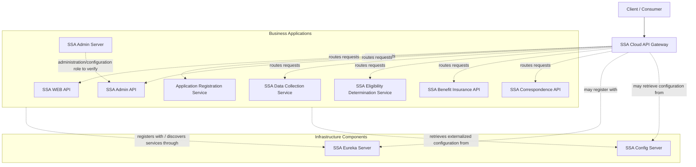
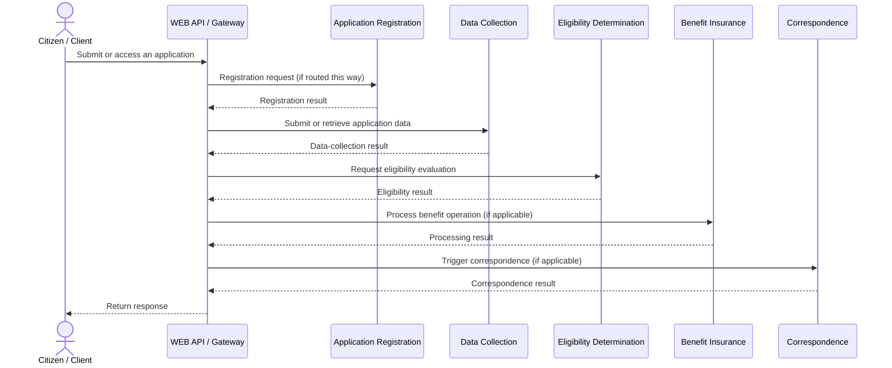

# Health Insurance Microservices

A Java-based, Spring Boot microservices project for managing a health-insurance assistance workflow, including citizen application registration, plan administration, data collection, eligibility determination, benefit processing, and correspondence.

> **Documentation status:** This is an initial README based on the repository structure and files visible in the project snapshot. Update the configuration-specific details (ports, database names, API routes, and exact versions) after verifying each service's `application.yml` / `application.yaml` and `pom.xml`.

---

## Table of Contents

- [Overview](#overview)
- [Architecture](#architecture)
- [Services and Modules](#services-and-modules)
- [Illustrative Business Workflow](#illustrative-business-workflow)
- [Technology Stack](#technology-stack)
- [Repository Structure](#repository-structure)
- [Prerequisites](#prerequisites)
- [Getting Started](#getting-started)
- [Suggested Startup Order](#suggested-startup-order)
- [Configuration](#configuration)
- [Testing](#testing)
- [Troubleshooting](#troubleshooting)
- [Security Notes](#security-notes)
- [Future Improvements](#future-improvements)
- [Contributing](#contributing)

---

## Overview

The project is organized as a collection of independently runnable Java applications. The modules separate business responsibilities from shared infrastructure such as API routing, service discovery, and centralized configuration.

### Main goals

- Separate business capabilities into focused services.
- Provide a central API entry point through an API Gateway.
- Support service registration and discovery through a Eureka Server.
- Keep application configuration in a dedicated Config Server module.
- Manage plan information, citizen applications, data-collection cases, eligibility results, benefit processing, and correspondence.
- Keep the codebase modular so services can be developed and tested independently.

## Architecture

The diagram below is a **high-level logical view** based on the module names. Exact runtime routes and direct service-to-service calls should be confirmed from the configuration and implementation.



### Architecture responsibilities

- **API Gateway:** A central entry point for routing incoming API requests. Confirm the configured routes before relying on specific URLs.
- **Service discovery:** Eureka provides a registry that applications can use to discover registered service instances when configured to do so.
- **Centralized configuration:** The Config Server module is intended to provide configuration to applications. Confirm its repository/backend configuration in the source.
- **Business services:** Each service owns a specific area of the insurance workflow.

The dashed arrows indicate intended or possible relationships, not verified runtime routes.

## Services and Modules

The repository contains the following 11 top-level modules.

| Module | Responsibility |
|---|---|
| `ApplicationRegistrationService` | Registers citizen/application information. The source contains a `CitizenAppRegistrationEntity`. |
| `SSA-AdminAPI` | Provides plan-administration functionality. The source contains plan and plan-category entities, a plan operation controller, and a plan management service. |
| `SSA-AdminServer` | Separate admin-related Spring Boot application. Its exact responsibilities and endpoints should be documented after inspecting its implementation. |
| `SSA-BenifitInsuranceAPI` | Benefit-insurance operations. The source includes a REST controller and Spring Batch-related configuration/processor classes. |
| `SSA-CloudAPIGateway` | Gateway application for handling and routing incoming requests. |
| `SSA-ConfigServerGit` | Config Server application; verify the configured configuration source and repository settings. |
| `SSA-CorrespondenceAPI` | Correspondence-related operations. The source includes a correspondence management service and `EmailUtils`. |
| `SSA-DataCollectionService` | Collects application-related data, including child, education, and income information; includes data-collection case entities. |
| `SSA-ElgibilityDeterminationService` | Eligibility determination operations. The source includes eligibility-related entities, repositories, a controller, and a global exception handler. |
| `SSA-EurekaServer` | Service-discovery registry application. |
| `SSA-WEB-API` | Web-facing API module; the source includes `SSAWebOperationRestController`. |

> Several folder names preserve the original project's spelling (for example, `Benifit` and `Elgibility`). They are kept as-is here so the documentation matches the repository paths.

## Illustrative Business Workflow

The following is a **conceptual workflow** for understanding the domain. The exact order and API calls must be verified against the controllers, service implementations, and configuration.



The diagram describes a possible end-to-end domain journey, not a guarantee that every request passes through every service.

## Technology Stack

The repository structure indicates a Java/Spring application ecosystem. Confirm exact versions and dependencies from each module's `pom.xml`.

- **Language:** Java
- **Application framework:** Spring Boot
- **Build tool:** Apache Maven (each module contains a `pom.xml` and Maven Wrapper files)
- **Service discovery:** Spring Cloud Netflix Eureka is suggested by the Eureka Server module; verify dependencies in the POMs
- **API gateway:** Spring Cloud Gateway is suggested by the Cloud API Gateway module; verify the dependency and route configuration
- **Centralized configuration:** Spring Cloud Config is suggested by the Config Server module; verify the implementation
- **Persistence:** JPA/repository-style persistence is visible in business modules; the exact database and driver should be confirmed in configuration
- **Batch processing:** Spring Batch-related classes are present in `SSA-BenifitInsuranceAPI`
- **Testing:** Test source files are included in the modules

Do not publish specific Java, Spring Boot, Spring Cloud, database, or port versions in this README until they have been checked against the actual project configuration.

## Repository Structure

```text
Insurance System for Health/
├── ApplicationRegistrationService/
├── SSA-AdminAPI/
├── SSA-AdminServer/
├── SSA-BenifitInsuranceAPI/
├── SSA-CloudAPIGateway/
├── SSA-ConfigServerGit/
├── SSA-CorrespondenceAPI/
├── SSA-DataCollectionService/
├── SSA-ElgibilityDeterminationService/
├── SSA-EurekaServer/
├── SSA-WEB-API/
├── .gitignore
└── README.md
```

Each application generally has its own Maven `pom.xml`, Maven Wrapper scripts, Java source code, resources, and test source. Not every module necessarily has the same files.

## Prerequisites

Install the following before running the applications:

1. **JDK:** Install the Java version required by the project POMs.
2. **Git:** To clone and manage the repository.
3. **Maven:** Optional if you use the included Maven Wrapper (`mvnw` / `mvnw.cmd`).
4. **Database:** Install and configure the database required by each service, based on its YAML configuration.
5. **IDE:** IntelliJ IDEA, Eclipse, or another Java IDE is recommended.

Check the Java and Git installations:

```bash
java -version
git --version
```

On Windows, use `mvnw.cmd` from a module directory. On Linux/macOS, use `./mvnw`.

## Getting Started

### 1. Clone the repository

```bash
git clone https://github.com/shivam-kg-se/health-insurance-microservices.git
cd health-insurance-microservices
```

### 2. Inspect service configuration

Before starting the services, inspect each module's `application.yml` or `application.yaml` and `pom.xml`.

Check at least:

- `server.port`
- `spring.application.name`
- Eureka client URL and registration settings
- Config Server URL / import settings
- Database URL, username, driver, and schema
- Gateway routes and service IDs
- Any required mail or external-service settings

Use environment variables or local configuration for credentials. Do not commit passwords, API keys, tokens, or other secrets.

### 3. Build a module

From a module directory on Windows:

```bash
cd SSA-EurekaServer
mvnw.cmd clean package
```

On Linux/macOS:

```bash
cd SSA-EurekaServer
./mvnw clean package
```

Repeat for the required modules. A root-level Maven build is not guaranteed because the repository currently appears to contain separate Maven projects rather than one parent multi-module build.

### 4. Run a module

From the selected module directory on Windows:

```bash
mvnw.cmd spring-boot:run
```

On Linux/macOS:

```bash
./mvnw spring-boot:run
```

Start one service at a time and verify its startup logs before proceeding. The exact commands may need adjustment if a module's POM does not include the Spring Boot Maven plugin.

## Suggested Startup Order

Use this as a **starting point only**; confirm the actual dependencies and configuration before following it.

1. `SSA-ConfigServerGit` — if the other services import configuration from it.
2. `SSA-EurekaServer` — if the services register with Eureka.
3. Business applications such as registration, admin, data collection, eligibility, benefit insurance, and correspondence.
4. `SSA-AdminServer` and `SSA-WEB-API` as required by their configuration and role.
5. `SSA-CloudAPIGateway` after the destination services and routes are configured.

If the Config Server depends on Eureka, or if services have different bootstrap requirements, adjust the order accordingly. Review startup logs and health endpoints rather than assuming that a process starting means the whole system is ready.

## Configuration

Configuration files are located under each module's `src/main/resources/` directory. File names vary between `application.yml` and `application.yaml`.

Example checklist (not a copy-paste configuration):

```yaml
# Illustrative keys only; use the actual values from your project.
spring:
  application:
    name: service-name

server:
  port: <configured-port>
```

Replace placeholders with the real settings. Do not paste real secrets into the README or public issue trackers.

### Configuration checklist

- [ ] Confirm every service's application name and port.
- [ ] Confirm whether the Config Server is actually used by each service.
- [ ] Confirm Eureka registration and discovery settings.
- [ ] Document gateway route predicates and destination service IDs.
- [ ] Document database type and schema setup.
- [ ] Document any email, file, or other external integrations.
- [ ] Move sensitive values out of committed configuration files.

## Testing

The repository contains test source files for the modules. Run tests from an individual module directory:

```bash
mvnw.cmd test
```

Use `./mvnw test` on Linux/macOS.

For a broader verification pass:

1. Run unit tests for each module.
2. Verify that each service can start with its intended configuration.
3. Verify Eureka registration where enabled.
4. Exercise gateway routes with a REST client.
5. Test key business flows across service boundaries.
6. Confirm error responses and validation behavior.

The presence of test files does not by itself guarantee that all tests pass; record the actual results after running them.

## Troubleshooting

### Service fails during startup

- Check the first meaningful exception in the logs.
- Confirm the configured Java version matches the project.
- Confirm the configured port is not already in use.
- Verify the required database and configuration server are reachable.

### Service does not appear in Eureka

- Check the Eureka client dependency and configuration.
- Confirm the registry URL and network connectivity.
- Verify the service's application name and registration settings.

### Gateway returns 404 or cannot reach a service

- Inspect the gateway route configuration.
- Confirm the route's service ID or destination URI matches the running service.
- Check whether service discovery is enabled and the destination service is healthy.
- Confirm the request path and HTTP method match the controller mapping.

### Database connection errors

- Verify database URL, driver, credentials, and schema.
- Confirm the database is running and reachable.
- Keep credentials outside source control.

### Maven build fails

- Check the JDK and Maven Wrapper versions.
- Read the first compiler or dependency-resolution error.
- Run `mvnw.cmd clean test` (Windows) or `./mvnw clean test` (Linux/macOS) inside the failing module.

## Security Notes

- Never commit real database passwords, email credentials, API keys, or tokens.
- Avoid storing personal or sensitive citizen data in sample files or public test fixtures.
- Use appropriate authentication, authorization, validation, and secure transport for deployed environments.
- Review generated reports and PDFs before publishing the repository to ensure they do not contain confidential information.
- Configure production secrets through environment variables or a dedicated secrets-management solution.

## Future Improvements

Possible improvements to consider as the project evolves:

- Add a verified architecture diagram showing actual routes and dependencies.
- Document API endpoints and example request/response payloads.
- Add health checks and consistent service observability.
- Add integration tests for cross-service workflows.
- Add Dockerfiles and Docker Compose for repeatable local startup, if containerization is desired.
- Add CI to build and test each service automatically.
- Document database schema and migration strategy.
- Standardize exception responses and API validation.
- Document service security and operational requirements.

## Contributing

1. Create a feature branch.
2. Make focused changes in the relevant service.
3. Run the tests for the changed module.
4. Update documentation when APIs, configuration, or service responsibilities change.
5. Open a pull request with a clear summary and test results.

---

## Project Status

This README is an initial project overview and can be refined as the implementation evolves. Replace illustrative flows with verified behavior, and add confirmed ports, endpoint tables, setup details, screenshots, and deployment instructions as they become available.
